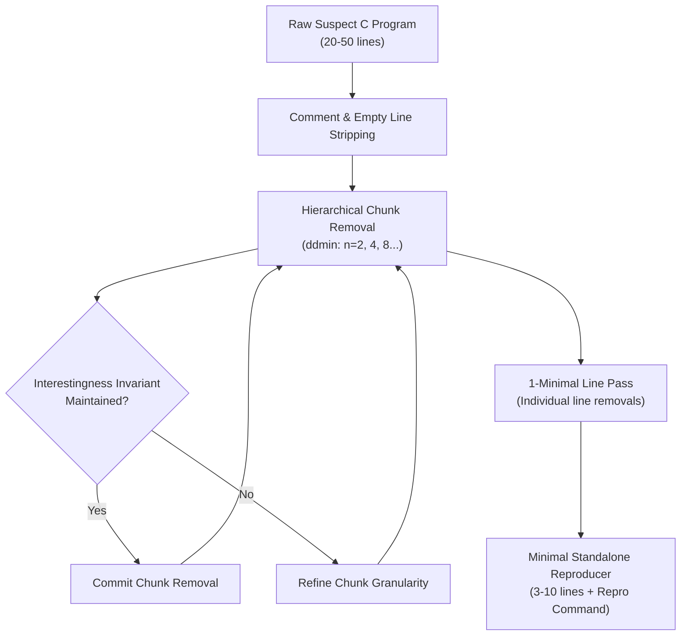

# Automated Test-Case Reduction Engine (Delta Debugging)

## 1. Overview & Research Goal

When an automated differential testing framework identifies a coverage discrepancy or compiler bug across thousands of generated test cases, the raw program often contains irrelevant declarations, formatting constructs, or control loops that obscure the root cause. Compiler maintainers (e.g., GCC Bugzilla, LLVM GitHub Issues) consistently reject non-minimal reproducers.

CovDiff-Lite implements an automated delta-debugging reduction engine in [`src/covdiff_lite/reduce.py`](file:///home/mahoraga/Software/CodeDiff-lite/src/covdiff_lite/reduce.py) to reduce suspect programs down to minimal 3-to-10 line reproducers suitable for upstream submission.

---

## 2. Reduction Invariant Preservation

The reducer applies the **ddmin (Delta Debugging Minimal)** algorithm across hierarchical code chunks and individual lines. For any proposed deletion, the candidate program must strictly satisfy the **Interestingness Invariant Predicate** $\mathcal{P}(C)$:

$$\mathcal{P}(C) = \text{CompilesCleanly}(C) \land (\text{Output}(C) == \text{Expected}) \land \text{PreservesDiscrepancy}(C)$$

1. **Syntax & Validity**: The candidate must compile under both GCC and Clang without fatal errors.
2. **Functional Determinism**: The candidate must produce the exact expected runtime output (stdout) and exit status.
3. **Discrepancy Invariant**: The candidate must retain the exact oracle contradiction or tool disagreement signature across clean runs.

---

## 3. Algorithm & Architecture

---

## 4. Evaluation & Verification

* Implemented in [`src/covdiff_lite/reduce.py`](file:///home/mahoraga/Software/CodeDiff-lite/src/covdiff_lite/reduce.py).
* Verified by [`tests/test_reduce.py`](file:///home/mahoraga/Software/CodeDiff-lite/tests/test_reduce.py), demonstrating effective reduction percentages (>60% size reduction) while strictly maintaining invariant execution semantics.
