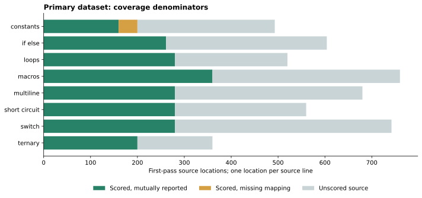
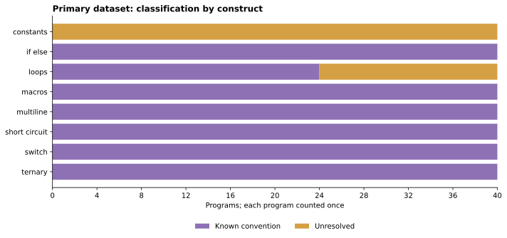
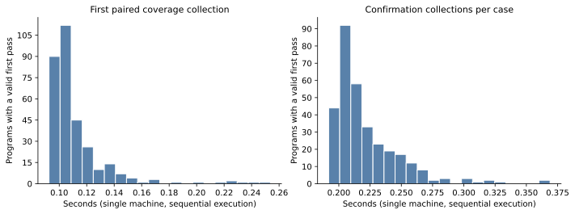

# CovDiff-Lite: final empirical analysis

The 320-program experiment found no incorrect counts at its comparable statement locations. It did find extensive, stable differences in which source lines the tools map and how they attribute counts to unscored syntax. A template-derived oracle, scoped convention rules, and layout controls separate these observations from probable coverage errors. Separately, two documented problem patterns reproduced with stable oracle contradictions, demonstrating that an otherwise clean generated corpus does not mean the detector cannot identify incorrect coverage.

The machine-readable analysis, tables and four figures are in [results/index.html](results/index.html), [results/metrics.json](results/metrics.json), and [results/tables/](results/tables/). The integrated local dashboard is `runs/final-report/index.html`. All primary measurements below come from the original frozen experiment; post-processing did not rerun or reclassify it.

## Research question and method

**How reliably do gcov and llvm-cov report line and branch coverage for common C constructs, and can a template-derived oracle distinguish probable errors from harmless reporting differences?**

We generated 40 distinct programs in each of eight construct families: if/else, loops, switch, short circuit, multiline conditions, ternary expressions, macros, and constants. Generation used finite parameter grids, seed `20261010`, generator/template version 1 and convention-rule version 1. Each deterministic C11 program has an independent semantic manifest recording selected statement counts, expected stdout/exit, semantic decisions, source locations and a source hash. Execution traces built with both compilers independently checked the model's event counts before coverage interpretation.

The primary image used GCC/gcov 11.4.0 and Clang/llvm-cov/llvm-profdata 14.0.0 at `-O0`. Coverage collections use fresh build/profile directories. Gcov JSON and LLVM JSON are normalized without replacing absent entries with zero; LLVM normalization is checked against native `llvm-cov show`. Raw JSON, logs, commands and original sources are preserved. See [the oracle contract](generator-oracle.md), [the discrepancy rules](discrepancy-analysis.md), and [measurement provenance](evidence/main-summary.json).

Every generated case had at least a mapping/convention finding, so all 320 received three clean paired collections. Their 960 collections comprise 1,920 instrumented executions; 640 separate executions validate noncoverage oracle traces. No otherwise-agreeing cases remained for the optional extra control sample. Pilot programs, documented fixtures and layout controls are separate datasets, never additions to the main sample size.

Semantic branch alignment was deferred: raw GCC arcs and LLVM branch regions are retained, but their identities cannot be equated merely by array position. Comparable branch outcomes are **zero**. The empirical conclusion therefore concerns line/statement reporting; this project does not answer the branch-reliability part of the original question.

## Pipeline success and statement agreement

| Measurement | Primary result | Denominator |
| --- | ---: | --- |
| Unique generated programs | 320 | 320 attempted |
| Valid model traces in both compilers | 320 | 320 programs |
| Successful first-pass paired coverage pipelines | 320 | 320 programs |
| Stable repeated cases | 320 | 320 repeated programs |
| Pipeline failures / unstable cases | 0 / 0 | 320 programs |
| Annotated oracle locations | 2,141 | selected statement locations |
| Mutually reported comparable locations | 2,101 | 2,141 annotated locations |
| Reported annotated locations: gcov / LLVM | 2,101 / 2,141 | per-tool mapping availability |
| Oracle contradictions: gcov / LLVM | 0 / 0 | 2,101 / 2,141 reported annotated locations |

Every attempted compilation, link, instrumented execution, extraction/export, merge and native-display command succeeded, including confirmations. The [stage table](results/tables/pipeline-stages.csv) reports successes, failures, timeouts and attempts separately for first passes and all collections. Unreached stages would not be counted as failed attempts. Case failures remain in overall totals and are excluded from agreement rates.

On the 2,101 mutually reported locations, both tools match the oracle: 4,202 tool–location comparisons with no contradiction. LLVM additionally reports 40 explicitly unreachable constant-body locations with the correct zero count; gcov elides them even at `-O0`. The oracle explicitly permits this narrow elision. These 40 locations are excluded from the common denominator, rather than treated as 40 incorrect zeros or missing executions.

There are 4,719 total source lines: 2,101 comparable locations, 40 scored locations with a missing mapping, and 2,578 unscored locations. Agreement on the scored subset is not a claim that all displayed source-line counts are semantically interchangeable.



## Why the tools disagree

| Saved case classification | Programs | Share of 320 |
| --- | ---: | ---: |
| Complete agreement, including no retained mapping findings | 0 | 0% |
| Known reporting-convention difference | 264 | 82.5% |
| Unresolved disagreement | 56 | 17.5% |
| Probable incorrect report | 0 | 0% |
| Unstable / pipeline failure | 0 / 0 | 0% / 0% |

These are mutually exclusive case labels. A program with correctly reported statements can still be classified as unresolved because an unscored header maps differently. Thus the absence of complete-agreement cases is compatible with complete agreement at comparable statements.

The raw comparison records 1,095 missing/present mapping differences and 25 count differences, all of which are also binary covered/uncovered differences. These are separate categories: a count comparison requires two reported counts. All 25 occur on unscored multiline-condition continuations where gcov reports zero and LLVM reports one. Neither tool's count alone supplies a universal statement-execution oracle for that syntax.

There are 1,120 discrepant source locations in this main dataset. Their findings divide into 1,051 scoped convention explanations and 69 unresolved observations. This reconciliation applies to these data, where no scored contradiction adds a second finding to a location; it is not a universal assumption about classifier output.

| Frozen convention rule | Explained observations |
| --- | ---: |
| Brace-line attribution | 866 |
| Unreachable literal-constant body elision | 40 |
| Statement-macro definition file-view attribution | 40 |
| Multiline condition-continuation attribution | 105 |
| **Total** | **1,051** |

| Reviewed unresolved pattern | Observations | Affected main cases |
| --- | ---: | ---: |
| Constant-condition header | 40 | 40 |
| `FLAG` macro-definition line | 13 | 13, within the same 40 constant cases |
| `do` loop header | 16 | 16 |
| **Total** | **69** | **56 distinct cases** |

The review audited raw evidence, outputs, repeat signatures and convention predicates for every main case. Gcov omits the unresolved locations while LLVM reports a count; surrounding scored statements agree with the oracle. Review did not invent expected counts for those headers or broaden rules to force agreement. These locations remain unresolved despite repeatability. See [the review record](evidence/main-review.json).



## What paired layouts establish

Sixteen semantic pairs, two per construct family, relocate braces while preserving C tokens, preprocessor directives, expected outputs, trace events and statement identities. All 32 programs passed their oracle/output checks across three collections. All 107 aligned semantic statement pairs preserved correct tool observations, including the explicitly permitted constant-body elisions.

Mapping differences nevertheless changed in **16/16 pairs**: 55 observations across parent layouts versus 127 across variants. Classifications changed in **13/16 pairs**, from known conventions to unresolved mappings. The 16 parent reruns reproduced their frozen main signatures exactly. The layout suite contains 13 known-convention and 19 unresolved cases; it is not merged into the 320-case result.

The added unresolved observations include separate function headers and `else` keywords. They expose a limitation of the frozen classifier: its existing convention rules cover the original layouts more completely. The intervention changes source attribution while preserving tested behavior and scored counts. It supports a layout-sensitivity explanation, not a new coverage bug claim. Details and paired statement evidence are in [layout-controls.md](layout-controls.md) and [the pair table](results/tables/layout-pairs.csv).

## Documented bugs validate detection separately

| Fixture | Oracle count | gcov | LLVM | Interpretation |
| --- | ---: | ---: | ---: | --- |
| GCC PR93680 case label | 1 | 3 | 1 | Stable documented case-label count inflation |
| LLVM #140427 following statement | 1 | 1 | 4 | Stable documented macro/return count inflation |
| LLVM #140427 never-executed variant | 0 | 0 | 2 | Stable false indication of execution |
| LLVM #140427 corrective control | 1 | 1 | 1 | Documented target symptom removed |

Each fixture received three clean collections and preserved expected functional output. The checks require the documented tool, statement identity and symptom, rather than any arbitrary disagreement. The never-executed variant strengthens the LLVM witness because the positive reported count contradicts binary coverage as well as an exact count. The corrective control removes that scored symptom while retaining unrelated unresolved mappings.

These results reproduce **two documented patterns**, across three positive fixtures and one control. They are not newly discovered bugs and are not observations from the main corpus. [The issue dossier](documented-issues.md) contains the upstream references, adaptations and raw-evidence rationale. Synthetic report mutations used in framework tests are excluded from all empirical counts.

## Cost on this machine

| Measurement | Main experiment |
| --- | ---: |
| Generation + analysis wall time | 130.66 s |
| Analysis including oracle traces and confirmations | 130.43 s |
| Mean / median first paired collection | 0.112 / 0.105 s |
| Nearest-rank p95 first paired collection | 0.148 s |
| Total confirmation-collection time | 70.92 s |
| Analysis wall time divided by programs, including traces/repeats | 0.408 s/program |
| Maximum individual child RSS | 88,480 KiB |
| Container cgroup peak memory | 425,414,656 bytes |
| Logical / allocated raw artifacts before summary | 166,837,259 / 240,574,464 bytes |

The run was sequential inside a four-CPU, 4 GiB container. Per-case coverage times exclude the earlier independent oracle-trace phase, whereas analysis wall time includes it. Confirmation time is the sum of two additional paired collections per case. Stage sums and per-case sums should not be substituted for total wall time. RSS and cgroup accounting describe different resource measures.



These are single-machine measurements, not a controlled tool-speed benchmark. Host load and filesystem cache can affect times. Image build/startup and later figures/dashboard generation are excluded. The reporting image adds pinned Matplotlib 3.5.1 to the original compiler image; its identity does not replace the measurement provenance of the frozen main run.

## Answer, limitations and delivered scope

For these deterministic templates and this tool version pair, both tools correctly report every scored statement count they expose. Large raw differences principally concern source attribution. The oracle identifies which statements have meaningful counts, convention rules explain scoped patterns, and a residual unresolved category prevents stable layout differences from becoming unsupported bug claims. Separate documented fixtures demonstrate detection of actual oracle contradictions.

The finite sample is not representative of arbitrary C programs. Related parameter variants are not independent random trials; no confidence interval or general bug probability is inferred. Shared oracle/parser errors remain possible despite independent trace validation and native-display/raw-report cross-checks. Results are limited to C11, bounded single-threaded programs, `-O0`, one compiler/reporter version pair, and one machine. More complex macros, optimizations, version comparisons and semantic branch alignment are outside the completed study.

The implemented core includes reproducible environments, generation, independent oracle validation, both coverage pipelines, normalization, classification, clean repeats, two documented patterns, the 320-case main experiment, findings review, layout controls, empirical tables/figures, an offline dashboard and a complete pipeline command. Automatic reduction and semantic branch comparison are not implemented. No previously unknown bug is claimed.

## Reproduce the analysis and full workflow

See [final-pipeline.md](final-pipeline.md) for build commands, the full one-command experiment, a smaller validation run, and the demonstration. Use a new output directory for every collection. Reporting the existing data does not require another main experiment:

```bash
bash scripts/env.sh empirical --analysis runs/main/analysis \
  --review docs/evidence/main-review.json \
  --documented-issues runs/documented-issues-verified \
  --layout-controls runs/layout-controls-verified \
  --layout-review docs/evidence/layout-controls-review.json \
  --output runs/empirical-rebuilt
```

All figures are standalone SVG and PNG files generated by [figures.py](../src/covdiff_lite/figures.py) from retained CSV plotting inputs. [publication.json](results/publication.json) records artifact hashes; [metrics.json](results/metrics.json) records measurement environments, source-summary hashes and aggregate evidence digests.
