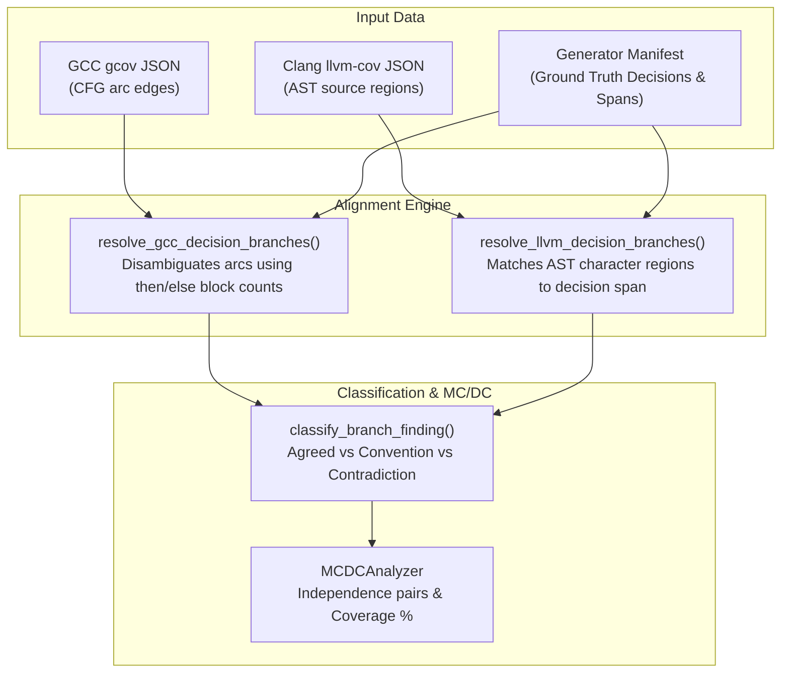

# Semantic Branch Coverage and MC/DC (Modified Condition/Decision Coverage)

## 1. Overview & Research Motivation

In safety-critical software systems (e.g., FAA DO-178C Level A for commercial avionics, ISO 26262 ASIL-D for automotive systems), line coverage is insufficient. Verification standards mandate **Branch Coverage** and **Modified Condition/Decision Coverage (MC/DC)**.

However, naive differential testing of branch coverage across C compilers fails immediately because compilers employ fundamentally conflicting architectures to represent control flow:
* **GCC (`gcov`)**: Operates on Basic Block Control Flow Graph (CFG) edge transitions (`branches` attached to source line basic blocks, annotated with flags like `fallthrough` and `throw`).
* **Clang (`llvm-cov`)**: Operates on Clang AST source character spans (`[lineStart, colStart, lineEnd, colEnd, trueCount, falseCount, ...]`).

Without an impartial, ground-truth referee, tool differences in arc generation cannot be classified as bugs versus structural representations.

---

## 2. Theoretical Foundations

### 2.1 Condition-Decision Trees & Truth Tables
A **decision** $D$ is a Boolean expression composed of logical operators (`&&`, `||`, `!`) and elementary conditions $c_1, \dots, c_n$.
The semantic oracle models full short-circuit evaluation semantics:
* In $c_1 \ \&\& \ c_2$, if $c_1$ evaluates to `False`, $c_2$ is unevaluated (`not_evaluated`).
* In $c_1 \ || \ c_2$, if $c_1$ evaluates to `True`, $c_2$ is unevaluated (`not_evaluated`).

### 2.2 MC/DC Independence Pairs
Under DO-178C, each elementary condition $c_i$ must be shown to independently affect the decision outcome $D$.
CovDiff-Lite evaluates both **Unique-Cause MC/DC** and **Masking MC/DC**:
1. **Unique-Cause MC/DC**: An independence pair consists of two test vectors $T_1$ and $T_2$ such that:
   * $c_i(T_1) \neq c_i(T_2)$.
   * $D(T_1) \neq D(T_2)$.
   * For all other conditions $c_j$ ($j \neq i$) evaluated in both vectors: $c_j(T_1) == c_j(T_2)$.
2. **Masking MC/DC**: Allows other conditions to vary if their variation is logically masked by short-circuit operators.

---

## 3. Architecture & Semantic Alignment Engine

The module [`src/covdiff_lite/branch_alignment.py`](file:///home/mahoraga/Software/CodeDiff-lite/src/covdiff_lite/branch_alignment.py) implements the mapping:

### 3.1 Discrepancy Classification Taxonomy
* **`complete_agreement`**: Both GCC and Clang report exact true/false branch counts matching ground truth oracle.
* **`known_branch_convention`**: Compiler-specific structural conventions, such as LLVM eliding branch regions on compile-time constants or GCC emitting implicit compiler return arcs.
* **`unresolved_edge_mapping`**: Branches cannot be unambiguously aligned to an AST decision span.
* **`candidate_incorrect_report`**: Aligned branch counts contradict the ground-truth oracle.

---

## 4. Verification & Validation

The implementation is verified by dedicated unit and integration tests in [`tests/test_mcdc.py`](file:///home/mahoraga/Software/CodeDiff-lite/tests/test_mcdc.py) and passes all 89 test cases across Docker and native environments.
