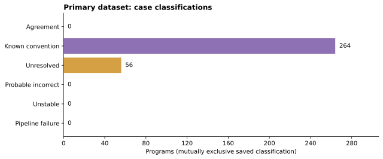
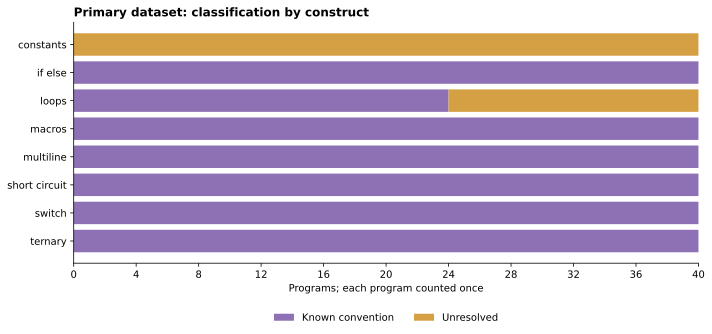
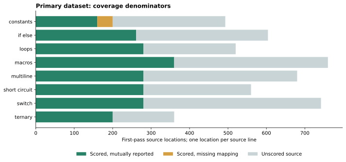
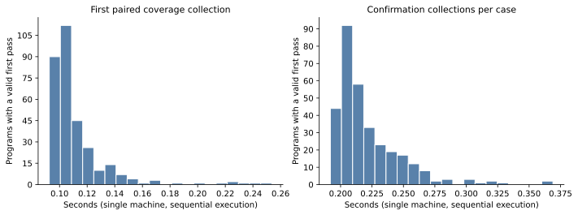

# CovDiff-Lite empirical analysis

## Result and interpretation

The primary dataset contains 320 programs and 320 distinct source hashes. 320 programs passed both functional pipelines and the trusted-oracle checks. There are 2101 valid mutually reported oracle locations and 0 contradictory tool–location observations.

The mutually exclusive case totals include 264 known-convention cases, 56 unresolved cases, 0 probable incorrect reports, 0 unstable cases, and 0 pipeline failures. Unresolved mappings are not established tool bugs. Agreement at these finite oracle locations is not a general reliability estimate.

## Denominators and reporting conventions

4719 source lines comprise 2141 annotated oracle locations and 2578 unscored locations. 40 annotated locations lack a mapping in at least one tool. Missing is never zero.

25 raw count differences include 25 binary differences; 1095 missing/present differences are counted separately. Raw observations cover unscored lines as well as statements. Convention observations count matched findings, not independent bugs.

| Tool | Reported oracle locations in valid cases | Contradictions | Contradictions on common locations |
| --- | --- | --- | --- |
| gcov | 2101 | 0 | 0 |
| llvm-cov | 2141 | 0 | 0 |

## Results by construct

| Family | Programs | Comparable | Scored unmapped | Known convention | Unresolved |
| --- | --- | --- | --- | --- | --- |
| constants | 40 | 160 | 40 | 0 | 40 |
| if_else | 40 | 261 | 0 | 40 | 0 |
| loops | 40 | 280 | 0 | 24 | 16 |
| macros | 40 | 360 | 0 | 40 | 0 |
| multiline | 40 | 280 | 0 | 40 | 0 |
| short_circuit | 40 | 280 | 0 | 40 | 0 |
| switch | 40 | 280 | 0 | 40 | 0 |
| ternary | 40 | 200 | 0 | 40 | 0 |

## Pipeline success denominators

First-pass stages below use attempted commands or available outputs/reports as their denominators. A stage never reached is not a failed attempt. All-collection totals, failures and timeouts are retained in pipeline-stages.csv.

| Tool | Stage | Successful / attempted |
| --- | --- | --- |
| gcov | compile | 320 / 320 |
| gcov | execute | 320 / 320 |
| gcov | extract | 320 / 320 |
| gcov | functional_output | 320 / 320 |
| gcov | link | 320 / 320 |
| gcov | parsed_report | 320 / 320 |
| llvm-cov | compile | 320 / 320 |
| llvm-cov | execute | 320 / 320 |
| llvm-cov | export | 320 / 320 |
| llvm-cov | functional_output | 320 / 320 |
| llvm-cov | merge | 320 / 320 |
| llvm-cov | normalization_validation | 320 / 320 |
| llvm-cov | parsed_report | 320 / 320 |
| llvm-cov | show | 320 / 320 |

## Repeatability and review

320 cases were repeated; 320 had stable saved signatures. There were 960 paired collections. A paired collection builds and runs both coverage pipelines; separate noncoverage oracle traces are not included in that count.

Review overlays retain original classifications. Reviewed unresolved patterns remain unresolved; any pending or manual inspection statuses remain visible.

| Review status | Cases |
| --- | --- |
| not_required | 264 |
| reviewed_mapping_unresolved | 56 |

## Convention rules and unresolved patterns

Each main-dataset difference is retained with its matched frozen rule or unresolved review pattern. These counts describe observations, not independent defects. Empty review-pattern counts mean no overlay was supplied.

| Rule or reviewed pattern | Observations |
| --- | --- |
| brace_line_attribution_v1 | 866 |
| constant_dead_body_elision_v1 | 40 |
| macro_definition_file_view_v1 | 40 |
| multiline_condition_attribution_v1 | 105 |
| constant_condition_header | 40 |
| constant_macro_definition | 13 |
| do_loop_header | 16 |

## Separate documented issue fixtures

2 distinct documented patterns reproduced across 4 fixtures. Positive variants and the corrective control are separate from the generated primary corpus. A positive variant is not another independent bug.

| Fixture | Tool | Role | Symptom check |
| --- | --- | --- | --- |
| gcc_pr93680 | gcov | positive | reproduced |
| llvm_140427 | llvm-cov | positive | reproduced |
| llvm_140427_control | llvm-cov | negative_control | control_passed |
| llvm_140427_never | llvm-cov | positive | reproduced |

## Separate paired layout controls

16/16 pairs passed over 107 semantic statement pairs. Mapping totals changed in 16 pairs and case classifications in 13 pairs. These changes are evidence of layout-sensitive reporting and rule matching, not new bugs.

The same scored statement observations can coexist with different displayed source mappings. Frozen convention rules are deliberately not broadened to absorb new layouts.

## Time and resource scope

Valid first-pass timing includes 320 cases: mean 0.11215522072452586, median 0.10452580521814525, nearest-rank p95 0.1481653731316328 seconds. Confirmation collections total 70.921890 seconds.

Recorded generation/analysis wall time: 130.65962782409042 seconds. Case coverage timings exclude the earlier oracle-trace phase; total analysis time includes it. Figures/reporting costs and Docker startup/build are separate. Command-stage time sums do not substitute for wall time.

RSS is the recorded maximum individual child, not aggregate memory. Container cgroup memory and artifact allocation are separate measures. Resource values belong to their saved experiment context, not to this post-processing run.

| Saved measurement | Value | Unit |
| --- | --- | --- |
| Generation time | 0.07547950511798263 | seconds |
| Analysis including traces and repeats | 130.43082821927965 | seconds |
| Generation + analysis wall time | 130.65962782409042 | seconds |
| Maximum individual child RSS | 88480 | KiB |
| Container cgroup peak memory | 425414656 | bytes |
| Container cgroup memory limit | 4294967296 | bytes |
| Pre-publication logical artifacts | 166837259 | bytes |
| Pre-publication allocated artifacts | 240574464 | bytes |

## Scope and limitations

The experiment uses finite deterministic C11 templates, one compiler/reporter version pair, -O0, bounded inputs, and one machine. Programs within a template family are related; case rates are descriptive and do not assume independent random sampling.

The semantic oracle is derived from templates and independently checked with execution traces, but an oracle or shared parser error remains possible. Native LLVM display checks and raw gcov evidence provide cross-checks. Unscored locations are excluded instead of assigned invented expected counts.

Semantic branch alignment and MC/DC are not implemented. Comparable branch outcomes are zero. Automatic reduction is not implemented. No previously unknown bug is claimed by this analysis.

## Figures and provenance

Machine-readable metrics and original measurement environments: [metrics.json](metrics.json). Plot inputs: [tables/](tables/). Figures can be regenerated using the plots command.
